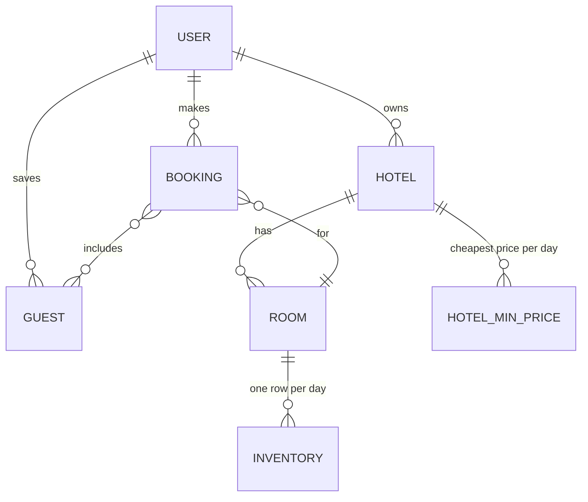
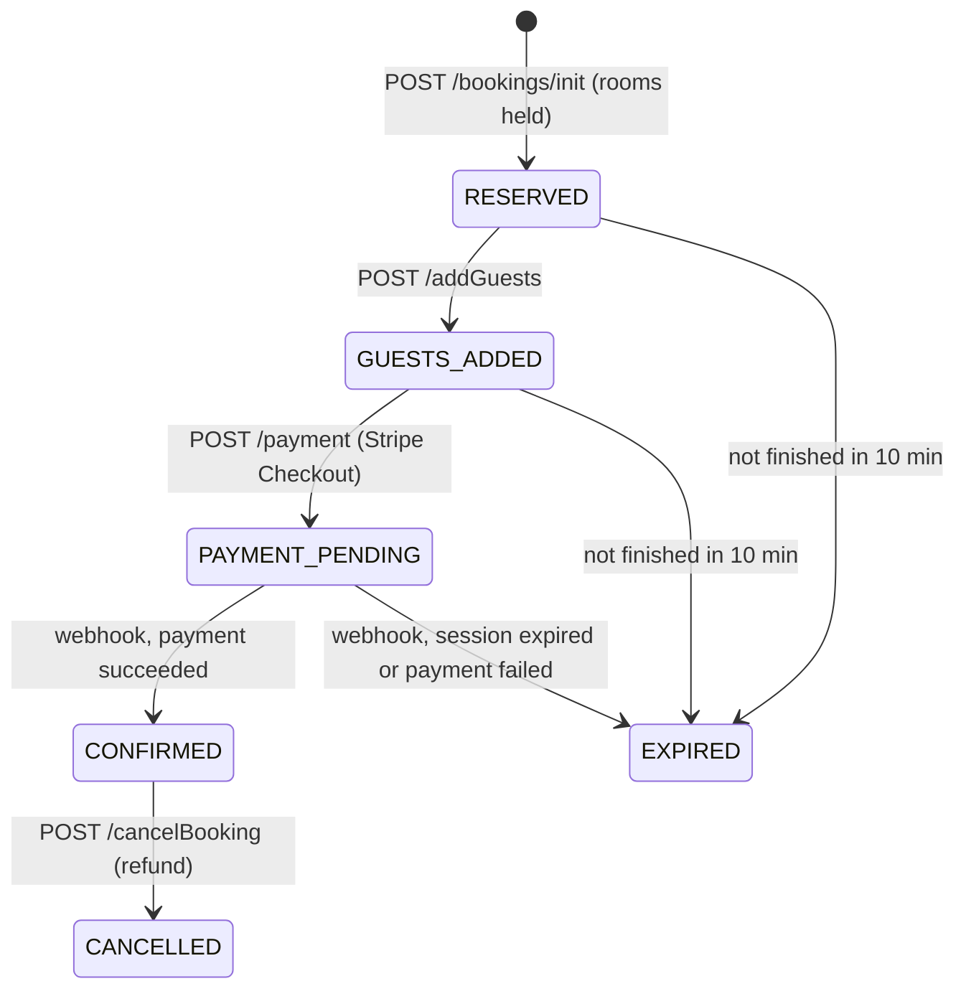

# Lease

[](https://github.com/ryuzaki07r/Lease/actions/workflows/tests.yml)

A REST API for booking hotel stays. Hotel managers list hotels, rooms and prices; guests search, book, pay with
Stripe and cancel. Built with Spring Boot and PostgreSQL.

- [Features](#features)
- [Tech stack](#tech-stack)
- [Getting started](#getting-started)
- [Project structure](#project-structure)
- [Data model](#data-model)
- [Authentication](#authentication)
- [API reference](#api-reference)
- [Booking and payment flow](#booking-and-payment-flow)
- [Dynamic pricing](#dynamic-pricing)
- [Background jobs](#background-jobs)
- [Concurrency](#concurrency)
- [Responses and errors](#responses-and-errors)
- [Testing](#testing)

## Features

- **Managers:** create hotels and room types, activate a hotel to put it on sale, close dates, set surge pricing,
  view bookings and revenue reports.
- **Guests:** search by city, dates and number of rooms; book; add travellers; pay through Stripe Checkout; cancel
  with an automatic refund.
- **Availability per night:** inventory is tracked per room type per day, so a hotel is only offered when every
  night of the stay has enough free rooms.
- **Dynamic pricing:** prices react to surge settings, occupancy and how soon the stay is.
- **Safe under load:** row locks prevent overbooking when many people book the last room at once.
- **Self-healing holds:** rooms held by abandoned bookings or expired payment pages are released automatically.

## Tech stack

| | |
|---|---|
| Language | Java 17+ (CI runs on Java 21) |
| Framework | Spring Boot 4 (Web MVC, Data JPA, Security, Validation) |
| Database | PostgreSQL |
| Auth | JWT (jjwt) with an HttpOnly refresh-token cookie |
| Payments | Stripe Checkout and webhooks (stripe-java) |
| Mapping | ModelMapper, Lombok |
| API docs | springdoc OpenAPI / Swagger UI |
| Tests | JUnit 5, Mockito, MockMvc, embedded PostgreSQL (zonky) |

## Getting started

### Prerequisites

- Java 17 or newer
- PostgreSQL
- A Stripe account (test mode is fine)

Maven does not need to be installed: the project ships with the Maven wrapper (`./mvnw`).

### Configuration

All secrets come from environment variables:

| Variable | Description |
|---|---|
| `DB_URL` | JDBC URL, e.g. `jdbc:postgresql://localhost:5432/lease` |
| `DB_USERNAME`, `DB_PASSWORD` | Database credentials |
| `JWT_SECRET` | Key for signing tokens, at least 32 characters |
| `FRONTEND_URL` | Origin of the frontend, e.g. `http://localhost:5173`. Used for CORS and Stripe redirect URLs |
| `STRIPE_SECRET_KEY` | Stripe secret key (`sk_test_...`) |
| `STRIPE_WEBHOOK_SECRET` | Signing secret of the Stripe webhook endpoint (`whsec_...`) |
| `SHOW_SQL` | Optional. `true` logs every SQL statement |

The schema is created and updated automatically by Hibernate (`spring.jpa.hibernate.ddl-auto=update`).

### Run

```bash
export DB_URL=jdbc:postgresql://localhost:5432/lease DB_USERNAME=postgres DB_PASSWORD=postgres
export JWT_SECRET=change-me-to-a-long-random-string-0123456789
export FRONTEND_URL=http://localhost:5173
export STRIPE_SECRET_KEY=sk_test_... STRIPE_WEBHOOK_SECRET=whsec_...

./mvnw spring-boot:run
```

The API is served at `http://localhost:8080/api/v1`, and Swagger UI at
`http://localhost:8080/api/v1/swagger-ui.html`.

### Stripe webhook

Point a Stripe webhook at `https://<your-host>/api/v1/webhook/payments` and subscribe it to:

- `checkout.session.completed`
- `checkout.session.async_payment_succeeded`
- `checkout.session.async_payment_failed`
- `checkout.session.expired`

Without `checkout.session.expired`, rooms held by unpaid checkouts are never released.

For local development, the Stripe CLI can forward events:

```bash
stripe listen --forward-to localhost:8080/api/v1/webhook/payments
```

### Creating a manager

Every signup gets the `GUEST` role. There is no API to create managers yet, so grant the role in the database:

```sql
UPDATE "User_roles" SET roles = 'MANAGER'
WHERE user_id = (SELECT id FROM app_user WHERE email = 'manager@example.com');
```

The table name is case-sensitive, so keep the double quotes.

## Project structure

```
src/main/java/com/rahul/Lease/
├── Controller/     REST endpoints
├── Services/       Business logic, plus the scheduled jobs
├── Repository/     Spring Data repositories and JPQL queries
├── Models/         JPA entities (database tables)
├── Dto/            Request and response objects
├── Security/       JWT, login, access rules
├── Strategy/       Pricing strategies
├── Advice/         Response wrapper and global exception handler
├── Exceptions/     Custom exceptions
├── Config/         Stripe, ModelMapper and Swagger setup
└── Utils/          Helpers (current user)
```

A request flows `JWTAuthFilter → Controller → Service → Repository → PostgreSQL`. Controllers handle HTTP and
validation, services hold the rules, repositories hold the queries.

## Data model



| Entity | Purpose |
|---|---|
| `User` | Account with roles `GUEST` and/or `MANAGER` |
| `Hotel` | Owned by a manager; hidden from search until activated |
| `Room` | A room type with base price, capacity and `totalCount` |
| `Inventory` | One row per room type per day for a year: `totalCount`, `bookCount`, `reservedCount`, `price`, `surgeFactor`, `closed` |
| `HotelMinPrice` | Cheapest price per hotel per day, used by search |
| `Booking` | Who, which room, dates, rooms, amount, status, Stripe session |
| `Guest` | Travellers saved by a user and attached to bookings |

Free rooms on a night are `totalCount - bookCount - reservedCount`. Stays are half-open: checking in on the 10th
and out on the 12th uses the nights of the 10th and 11th.

## Authentication

1. `POST /auth/signup` creates a `GUEST` account. Passwords are stored as bcrypt hashes.
2. `POST /auth/login` returns an **access token** (10 minutes) in the body and sets a **refresh token**
   (6 months) as an `HttpOnly`, `Secure`, `SameSite=Strict` cookie on `/api/v1/auth`.
3. Send the access token on every request: `Authorization: Bearer <token>`.
4. `POST /auth/refresh` exchanges the cookie for a new access token.

Tokens carry a type, so a refresh token is rejected as an access token and vice versa.

| Path | Access |
|---|---|
| `/admin/**` | `MANAGER` role |
| `/bookings/**`, `/users/**` | Any logged-in user |
| Everything else | Public |

Missing or invalid credentials return `401`; a logged-in user without permission gets `403`.

## API reference

All paths are relative to `/api/v1`. Swagger UI has the full request and response schemas.

### Auth

| Method | Path | Description |
|---|---|---|
| POST | `/auth/signup` | Create an account |
| POST | `/auth/login` | Log in |
| POST | `/auth/refresh` | New access token from the refresh cookie |

### Browse (public)

| Method | Path | Description |
|---|---|---|
| GET | `/hotels/search?city=&startDate=&endDate=&roomsCount=&page=&size=` | Hotels with enough free rooms every night. `endDate` is the checkout date |
| GET | `/hotels/{hotelId}/info` | Hotel details and its rooms |

### Bookings (logged in)

| Method | Path | Description |
|---|---|---|
| POST | `/bookings/init` | Hold rooms for a stay |
| POST | `/bookings/{id}/addGuests` | Add travellers |
| POST | `/bookings/{id}/payment` | Start payment; returns the Stripe Checkout URL |
| GET | `/bookings/{id}/status` | Booking status |
| POST | `/bookings/{id}/cancelBooking` | Cancel a confirmed booking before check-in and refund it |

### User (logged in)

| Method | Path | Description |
|---|---|---|
| GET / PATCH | `/users/profile` | View or update your profile |
| GET | `/users/myBookings` | Your bookings |
| GET / POST | `/users/guests` | List or add saved guests |
| PUT / DELETE | `/users/guests/{guestId}` | Update or delete a saved guest |

### Hotel management (managers)

| Method | Path | Description |
|---|---|---|
| GET / POST | `/admin/hotels` | Your hotels / create a hotel |
| GET / PUT / DELETE | `/admin/hotels/{hotelId}` | Read, update or delete a hotel (no delete once it has bookings) |
| PATCH | `/admin/hotels/{hotelId}/activate` | Put a hotel on sale: creates inventory and prices |
| GET | `/admin/hotels/{hotelId}/bookings` | All bookings for a hotel |
| GET | `/admin/hotels/{hotelId}/reports?startDate=&endDate=` | Confirmed bookings, revenue, average revenue |
| GET / POST | `/admin/hotels/{hotelId}/rooms` | List or add room types |
| GET / PUT / DELETE | `/admin/hotels/{hotelId}/rooms/{roomId}` | Read, update or delete a room type |
| GET | `/admin/inventory/rooms/{roomId}` | Inventory of a room type |
| PATCH | `/admin/inventory/rooms/{roomId}` | Set surge factor or close dates for a date range |

### Webhook

| Method | Path | Description |
|---|---|---|
| POST | `/webhook/payments` | Stripe events; requires a valid `Stripe-Signature` header |

### Example

```bash
API=http://localhost:8080/api/v1
TOKEN=$(curl -s $API/auth/login -H 'Content-Type: application/json' \
  -d '{"email":"guest@example.com","password":"password123"}' | jq -r .data.accessToken)

curl "$API/hotels/search?city=Pune&startDate=2026-12-10&endDate=2026-12-12&roomsCount=1"

curl $API/bookings/init -H "Authorization: Bearer $TOKEN" -H 'Content-Type: application/json' \
  -d '{"hotelId":1,"roomId":1,"checkInDate":"2026-12-10","checkOutDate":"2026-12-12","roomsCount":1}'
```

## Booking and payment flow



1. **Hold.** `init` locks the inventory rows for the stay, checks every night has enough free rooms and adds to
   `reservedCount`. The price is the sum of each night's dynamic price times the number of rooms.
2. **Guests.** Travellers are attached to the booking.
3. **Pay.** A Stripe Checkout session (valid for 30 minutes) is created and its URL returned; the frontend
   redirects the user there.
4. **Confirm.** Stripe calls the webhook. After verifying the signature, a paid session moves the rooms from
   `reservedCount` to `bookCount`. Repeated deliveries of the same event are ignored, and payments arriving for a
   booking that already expired are refunded.
5. **Cancel.** Confirmed bookings can be cancelled before the check-in date. The rooms are released and the
   payment refunded; if the refund fails, the cancellation is rolled back.

## Dynamic pricing

Each night's price is built by stacking strategies (decorator pattern):

| Strategy | Rule |
|---|---|
| `BasePricingStrategy` | Room's base price |
| `SurgePricingStrategy` | × the manager's surge factor |
| `OccupancyPricingStrategy` | × 1.12 when more than 80% of rooms are booked |
| `UrgencyPricingStrategy` | × 1.10 for nights within the next 7 days |

To add a rule, write a new `PricingStrategy` and add it to the chain in `PricingService`.

## Background jobs

| Job | Schedule | Purpose |
|---|---|---|
| `BookingExpiryScheduler` | Every minute (`booking.expiry.check-interval-ms`) | Expires bookings left in `RESERVED` or `GUESTS_ADDED` for over 10 minutes and releases their rooms |
| `PricingUpdateService` | Hourly | Recalculates inventory prices and `HotelMinPrice`, one transaction per hotel |

## Concurrency

Booking and webhook handling take pessimistic row locks (`SELECT ... FOR UPDATE`) on the inventory and booking
rows they change. When several users request the last room at the same time, one succeeds and the others get
`409 Conflict`; the expiry job, webhooks and user actions never overwrite each other's status changes.

## Responses and errors

Successful responses are wrapped:

```json
{ "dateTime": "2026-11-12T10:15:30", "data": { } }
```

Errors use the same envelope:

```json
{ "dateTime": "2026-11-12T10:15:30", "error": { "status": "409 CONFLICT", "message": "Selected room is not available anymore", "subErrors": null } }
```

| Status | When |
|---|---|
| 400 | Invalid input (`subErrors` lists each field) |
| 401 | Missing or invalid token |
| 403 | Not allowed (wrong role or not the owner) |
| 404 | Not found |
| 405 | Wrong HTTP method |
| 409 | Conflict, e.g. sold out, wrong booking status, duplicate email |
| 502 | Stripe request failed |
| 500 | Unexpected error (details are logged, not returned) |

## Testing

```bash
./mvnw test     # unit tests, about a second
./mvnw verify   # unit + integration tests, about a minute
```

No database or Docker is needed: integration tests start an embedded PostgreSQL automatically.

### Unit tests

`src/test/java/com/rahul/Lease/{Services,Security,Strategy}`. Each test checks one class with its dependencies
replaced by Mockito mocks.

| Test | Covers |
|---|---|
| `BookingServiceImplTest` | Booking rules, every Stripe event type, duplicate events, expiry, cancellation, refund idempotency, reports |
| `BookingExpirySchedulerTest` | Expiry job keeps going when one booking fails |
| `JWTServiceTest` | Token round trips, wrong type, wrong key, tampering |
| `PricingServiceTest` | Each pricing rule and their combination |
| `InventoryServiceImplTest` | Search counts nights, not days; a year of inventory for new rooms |
| `AuthServiceTest` | Duplicate email, hashed password, default role |

### Integration tests

`src/test/java/com/rahul/Lease/integration` and `LeaseApplicationIT`, named `*IT` and run by Maven Failsafe.
They boot the full application against a real PostgreSQL and call the API through MockMvc, so queries, locks,
transactions and security rules run as in production. `IntegrationTestBase` provides the database, test
settings and helpers, signs fake Stripe webhooks, and points Stripe at an unreachable address so tests never
call the real API.

| Test | Covers |
|---|---|
| `LeaseApplicationIT` | Application starts (all queries validate); API docs load |
| `AuthIT` | Signup, login, refresh cookie, token misuse, deleted users, roles |
| `HotelManagementIT` | Hotels, rooms, activation, delete rules, search, closed dates, inventory, reports |
| `BookingFlowIT` | Full booking life cycle, webhooks, expiry, cancellation rollback, concurrent bookings for the last room |
| `ErrorHandlingIT` | 400, 404, 405 and CORS |

### Continuous integration

GitHub Actions ([`.github/workflows/tests.yml`](.github/workflows/tests.yml)) runs `./mvnw verify` on every push
to `main` and on every pull request. Test reports are uploaded when a run fails.

Not covered by automated tests: creating a real Stripe Checkout session and a successful refund, which need a
live Stripe test key.
